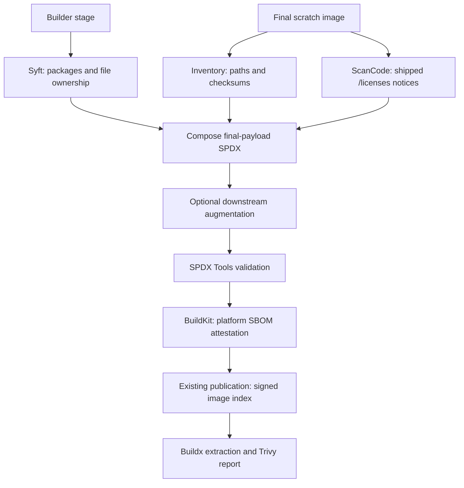

# SBOM generator reviewer guide

The final image is built `FROM scratch`: it retains extension files and libraries,
but no package database. The generator uses the builder's package evidence to
identify the files actually shipped, excluding packages with no matched files.
It runs as a BuildKit scanner; its tools are not added to the extension image.



Files are copied to different locations in the scratch image: for example,
`/usr/share/doc/gcc-12-base/copyright` becomes `/licenses/gcc-12-base/copyright`.
The final path therefore cannot be used directly to look up Debian ownership.
We match each shipped file to its original builder file, then retain the package
that owned that builder file.

Ownership requires matching SHA256 content. Exact paths and shared path suffixes
rank candidates; ambiguous matches stay unclaimed. The composer retains owning
packages and their relationships, adds Debian distribution context for consumers,
and merges license evidence. It does not infer ownership from a license-directory
name. Large copyright files are split for scanning, then findings are mapped back
to their original file paths.

## Where to review

| Area | Entry points |
| --- | --- |
| Scanner lifecycle, final inventory, ScanCode invocation, BuildKit statement | [generator.py](generator.py) |
| File ownership, package selection, license composition, document identity | [compose.py](compose.py) |
| Optional hook and its context | [hooks.py](hooks.py) |
| Final SPDX conformance check | [spdx_validation.py](spdx_validation.py), [validator pin](requirements-validation.txt) |
| Scanner image and dependencies | [Dockerfile](Dockerfile) |
| Extension integration | [docker-bake.hcl](../docker-bake.hcl), [bake_targets.yml](../.github/workflows/bake_targets.yml) |
| Generator checks, publication, and digest updates | [sbom-generator.yml](../.github/workflows/sbom-generator.yml), [release.py](release.py), [renovate.json](../renovate.json) |
| Unit checks and real BuildKit/SPDX/Trivy fixture | [tests](tests), [integration](tests/integration) |

CI selects the digest-pinned scanner and inserts
`ARG BUILDKIT_SBOM_SCAN_STAGE=builder` into the Dockerfile so BuildKit exposes the
builder stage. Ordinary local Bake builds use the default scanner when
`sbom_generator` is empty. BuildKit produces detailed provenance (`mode=max`);
the SLSA reusable workflow
adds signed provenance for each published index. Testing provenance gates
production copying; production provenance is generated at the destination.
This SBOM generator produces the SPDX predicate only.

## Downstream augmentation

A builder may supply `/usr/local/share/cnpg-sbom/augment_spdx.py` with
`augment_spdx(document, context) -> dict`. The hook runs after composition and
before validation. [HookContext](hooks.py) exposes API version 1, extension name,
platform, builder/final paths, and the complete Syft builder document.

The hook executes trusted Python in the generator environment. Builder-installed
dependencies are unavailable there; downstream builds can prepare JSON evidence
for the hook to read. Missing hooks leave the document unchanged; hook errors or
invalid final SPDX fail the build. SPDX validation checks conformance, not whether
added components actually belong to the payload.

PGRX is a downstream consumer of this interface: it supplies Cargo component and
license evidence. The core generator has no Cargo or PGRX processing dependency.
The [fixture hook](tests/integration/fixture/augment_spdx.py) demonstrates adding
a package that Trivy can report.

## Local checks

From the repository root:

```bash
python3 -m venv /tmp/cnpg-spdx-venv
/tmp/cnpg-spdx-venv/bin/pip install -r sbom-generator/requirements-validation.txt
/tmp/cnpg-spdx-venv/bin/python -m unittest discover -s sbom-generator/tests
/tmp/cnpg-spdx-venv/bin/python sbom-generator/spdx_validation.py pgsphere-amd64.spdx.json
```

The validator accepts extracted SPDX or the generator's in-toto statement and
exits nonzero on invalid output. Native AMD64 and ARM64 CI checks also build the
scanner and exercise a real BuildKit attestation, Debian notice ownership, hook
augmentation, and Trivy license reporting.

See the [user and release guide](README.md) for inspection and publication commands.

## Release promotion

The publish job is serialized. Once its digest passes checks, a `main` push
updates `latest` even if unrelated commits have since advanced `main`.
`release.py` verifies the immutable commit tag and promoted alias against the
checked digest. GitHub does not guarantee queue order, so serialization alone
does not enforce source-commit order for publications.
